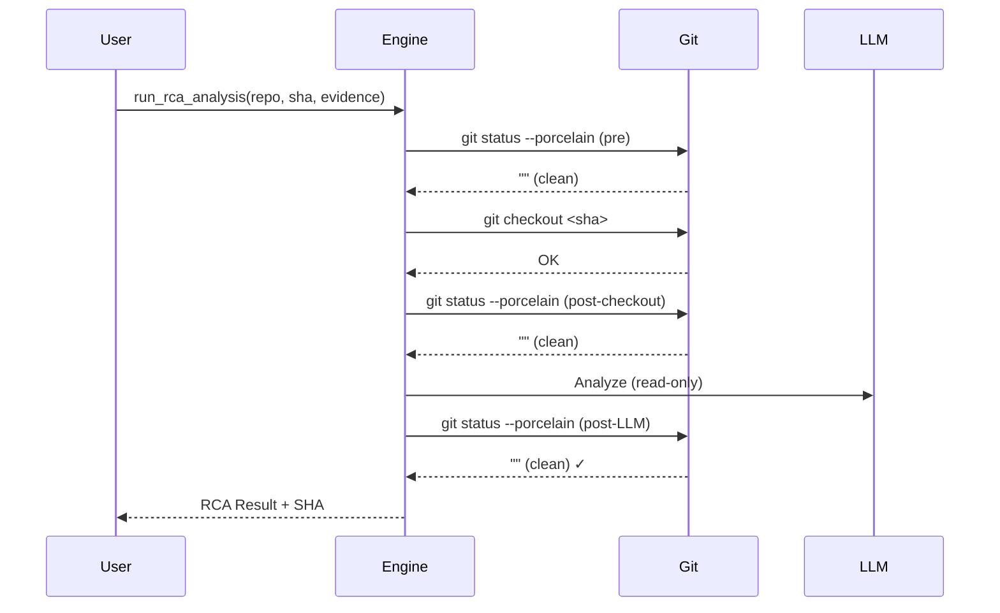

# SAFI Root Cause Analyzer (Product 010) — Documentation

> **Trainable Root Cause Analyzer** — A production-grade, read-only diagnostic system that binds to an exact Git SHA, assembles repository context (SOW, AGENTS.md, Aider RepoMap, skills), and invokes a deterministic LLM to distinguish root cause from symptom.

---

## 1. System Overview

**SAFI RCA (Product 010)** is a **Trainable Root Cause Analyzer** designed for software engineering teams who need precise, auditable, and reproducible failure diagnosis. Unlike generic log summarizers, SAFI RCA:

- **Binds to an exact Git commit SHA** — Analysis is grounded to a specific, immutable code state.
- **Enforces read-only execution** — Pre- and post-run `git status --porcelain` validation guarantees zero repository mutations.
- **Assembles full context** — SOW, README, AGENTS.md, Aider RepoMap, role skill, and failure evidence.
- **Uses deterministic LLM reasoning** — Temperature 0.1, JSON-only output, structured schema.
- **Exports machine-readable results** — JSON schema for CI/CD integration, audit trails, and downstream automation.

### Key Differentiators

| Feature | SAFI RCA | Generic Log Analyzers |
|---------|----------|----------------------|
| SHA Binding | ✅ Exact commit | ❌ Latest/HEAD |
| Read-Only Guarantee | ✅ Git-verified | ❌ Not enforced |
| Repository Context | ✅ RepoMap + Skills | ❌ Snippet-only |
| Output Schema | ✅ Strict JSON | ❌ Free text |
| Reproducibility | ✅ Deterministic | ❌ Variable |
| CI/CD Integration | ✅ Native JSON | ❌ Manual parsing |

---

## 2. Architecture & Runtime

### 2.1 High-Level Architecture

```
┌─────────────────────────────────────────────────────────────────┐
│                        USER INTERFACE                            │
│  ┌─────────────────┐          ┌─────────────────────────────┐   │
│  │  CLI (rca_engine) │          │  Streamlit Chat (app.py)   │   │
│  └────────┬──────────┘          └──────────────┬──────────────┘   │
└───────────┼────────────────────────────────────┼──────────────────┘
            │                                    │
            ▼                                    ▼
┌─────────────────────────────────────────────────────────────────┐
│                    RCA ENGINE (rca_engine.py)                    │
│  ┌──────────────┐  ┌──────────────┐  ┌──────────────────────┐  │
│  │ Git Ops      │  │ Context      │  │ LLM Orchestration    │  │
│  │ (verify,     │──│ Assembly     │──│ (Nemotron 3 Ultra,   │  │
│  │  checkout,   │  │ (SOW,        │  │  temp=0.1, JSON)    │  │
│  │  status)     │  │  RepoMap,    │  │                      │  │
│  └──────────────┘  │  Skills,     │  └──────────────────────┘  │
│                    │  Evidence)   │                              │
│                    └──────────────┘                              │
└─────────────────────────────────────────────────────────────────┘
            │
            ▼
┌─────────────────────────────────────────────────────────────────┐
│                    EXTERNAL TOOLS & ARTIFACTS                    │
│  ┌──────────┐  ┌──────────┐  ┌──────────┐  ┌────────────────┐  │
│  │ Git      │  │ Aider    │  │ OpenAI-  │  │ .agents/skills/│  │
│  │ (plumbing)│  │ RepoMap  │  │ compat   │  │ root-cause-    │  │
│  └──────────┘  └──────────┘  └──────────┘  │ analyzer.md    │  │
│                                             └────────────────┘  │
└─────────────────────────────────────────────────────────────────┘
```

### 2.2 Runtime Components

| Component | Technology | Purpose |
|-----------|------------|---------|
| **Agent Runtime** | OpenHands-compatible | Stateful, durable execution environment |
| **RepoMap Generator** | Aider (`--show-repo-map`) | AST-based repository structure map |
| **Repo Training** | `AGENTS.md` | Project-specific conventions, invariants, architecture |
| **Role Training** | `.agents/skills/root-cause-analyzer.md` | Domain-specific directives, output schema, few-shot guidance |
| **LLM Provider** | Nemotron 3 Ultra (OpenAI-compatible) | Deterministic code reasoning, JSON output |
| **Frontend** | Streamlit | Interactive chat UI with report rendering & download |

### 2.3 Context Pipeline

The following artifacts are assembled into the LLM prompt in order:

1. **Failure Evidence** — Raw logs, stack traces, error messages (user-provided)
2. **Statement of Work (SOW)** — Requirements, constraints, acceptance criteria (optional)
3. **README.md** — Project overview, setup, usage
4. **AGENTS.md** — Repository conventions, invariants, architecture guidelines
5. **Root Cause Analyzer Skill** — Role directives, output schema, reasoning framework
6. **Aider RepoMap** — File tree, symbol index, call graph summary
7. **Target SHA** — Exact commit hash for grounding

---

## 3. Exact SHA Binding & Read-Only Invariant

### 3.1 SHA Binding

Every analysis run is **cryptographically bound** to a specific Git commit:

```python
def verify_and_prep_git(repo_path: str, sha: str) -> None:
    # 1. Validate repo_path is a Git work tree
    # 2. Assert working tree is CLEAN before checkout
    # 3. Checkout exact SHA: git checkout <sha>
    # 4. Assert working tree is CLEAN after checkout
```

**Guarantees:**
- Analysis **always** runs against the exact code state at `sha`
- No "works on my machine" drift — SHA is recorded in output JSON
- Enables audit trails: "This diagnosis applies to commit `abc123`"

### 3.2 Read-Only Invariant

The system enforces **zero mutations** via dual `git status --porcelain` checks:



**If any check fails:**
- `RuntimeError` raised immediately
- `git reset --hard <sha>` executed to restore state
- Analysis aborted, no partial results returned

### 3.3 Verification in Tests

```bash
# Test validates pre/post git status is empty
pytest tests/test_rca.py::test_read_only_invariant -v
```

---

## 4. Setup & Installation

### 4.1 Prerequisites

- **Python 3.12+** (tested on 3.12, compatible with 3.10+)
- **Git** (for repository operations)
- **Aider** (for RepoMap generation): `pip install aider-chat`
- **OpenAI-compatible API endpoint** (Nemotron 3 Ultra or equivalent)

### 4.2 Virtual Environment Setup

```bash
# Clone or navigate to project
cd safi-rca-tool

# Create virtual environment
python3.12 -m venv .venv
source .venv/bin/activate

# Upgrade pip
pip install --upgrade pip

# Install dependencies
pip install -r requirements.txt
```

### 4.3 Requirements (`requirements.txt`)

```txt
openai>=1.0.0
streamlit>=1.30.0
pytest>=8.0.0
pytest-mock>=3.12.0
```

### 4.4 Environment Variables

Create a `.env` file or export in shell:

```bash
# Required: Model name (default: Nemotron 3 Ultra)
export RCA_MODEL_NAME="Nemotron 3 Ultra"

# Required: API endpoint (OpenAI-compatible)
export RCA_API_BASE_URL="https://your-endpoint.example.com/v1"

# Required: API key
export RCA_API_KEY="sk-xxxxxxxxxxxxx"

# Optional: Request timeout (seconds)
export RCA_TIMEOUT="120"
```

---

## 5. CLI Execution

### 5.1 Command Syntax

```bash
python rca_engine.py analyze \
  --repo <REPO_PATH> \
  --sha <GIT_SHA> \
  --evidence <EVIDENCE_FILE> \
  [--sow <SOW_FILE>]
```

### 5.2 Arguments

| Flag | Required | Description |
|------|----------|-------------|
| `--repo` | ✅ | Absolute or relative path to Git repository |
| `--sha` | ✅ | Exact Git commit SHA (full or short) |
| `--evidence` | ✅ | Path to failure evidence file (`.txt`, `.log`) |
| `--sow` | ❌ | Path to Statement of Work (`.md`) |

### 5.3 Example

```bash
# From project root
python rca_engine.py analyze \
  --repo /path/to/payment-service \
  --sha 8f51ab2d3c4e5f6a7b8c9d0e1f2a3b4c5d6e7f8 \
  --evidence ./failure_traces/payment_error.log \
  --sow ./docs/SOW-payment.md
```

### 5.4 Output

**Stdout (JSON only — for piping):**
```json
{
  "repo": "/path/to/payment-service",
  "sha": "8f51ab2d3c4e5f6a7b8c9d0e1f2a3b4c5d6e7f8",
  "role": "root-cause-analyzer",
  "root_cause": "Null pointer dereference in validate_transaction when user_record is None",
  "affected_component": "src/validator.py:validate_transaction",
  "evidence": [
    "src/validator.py:3",
    "AttributeError: 'NoneType' object has no attribute 'get'"
  ],
  "confidence": "High",
  "uncertainty": "None",
  "recommended_next_action": "Add null check at start of validate_transaction: if user_record is None: return False"
}
```

**Stderr (Human-readable summary):**
```
============================================================
ROOT CAUSE ANALYSIS RESULT
============================================================
Repository: /path/to/payment-service
SHA: 8f51ab2d3c4e5f6a7b8c9d0e1f2a3b4c5d6e7f8
Role: root-cause-analyzer
Confidence: High
------------------------------------------------------------
ROOT CAUSE: Null pointer dereference in validate_transaction when user_record is None
AFFECTED COMPONENT: src/validator.py:validate_transaction
------------------------------------------------------------
EVIDENCE:
  - src/validator.py:3
  - AttributeError: 'NoneType' object has no attribute 'get'
------------------------------------------------------------
UNCERTAINTY: None
------------------------------------------------------------
RECOMMENDED NEXT ACTION: Add null check at start of validate_transaction: if user_record is None: return False
============================================================
```

### 5.5 Exit Codes

| Code | Meaning |
|------|---------|
| `0` | Success — JSON printed to stdout |
| `1` | Error — Details on stderr |

---

## 6. Web Chatbot (Streamlit)

### 6.1 Launch

```bash
# Activate venv first
source .venv/bin/activate

# Run Streamlit app
streamlit run app.py
```

Opens at `http://localhost:8501`

### 6.2 UI Walkthrough

#### Sidebar (Configuration)
```
┌─────────────────────────────────────┐
│ 🔧 Analysis Configuration           │
├─────────────────────────────────────┤
│ Target Repo Path    [/path/to/repo  ]│
│ Exact Git SHA       [8f51ab2       ]│
│ Statement of Work   [Browse... (.md)]│
│ Failure Evidence    [Browse... .txt]│
│                                     │
│ [🚀 Run Root Cause Analysis]        │
├─────────────────────────────────────┤
│ ✅ Analysis complete!               │
│ SHA: 8f51ab2...                     │
│ Confidence: High                    │
└─────────────────────────────────────┘
```

#### Main Chat Area

**Before Analysis:**
```
🤖 Assistant: Welcome to the SAFI Root Cause Analyzer!
To get started, please provide in the sidebar:
1. Target Repo Path
2. Exact Git SHA
3. Failure Evidence (.txt/.log)
4. Statement of Work (optional .md)
Then click "Run Root Cause Analysis"
```

**After Analysis (Structured Report):**
```
📋 Root Cause Analysis Report

Target SHA: `8f51ab2d3c4e...` | Confidence: 🟢 High

🎯 Affected Component
`src/validator.py:validate_transaction`

🔬 Root Cause
Null pointer dereference in validate_transaction when user_record is None

📎 Evidence
- `src/validator.py:3`
- `AttributeError: 'NoneType' object has no attribute 'get'`

❓ Uncertainty
None

🛠️ Recommended Next Action
Add null check at start of validate_transaction: if user_record is None: return False

[📥 Download RCA JSON Report]
```

**Follow-Up Q&A:**
```
👤 User: Can you explain why the null check wasn't caught by tests?
🤖 Assistant: Based on the RCA result, the affected component is 
`src/validator.py:validate_transaction`. The root cause is an unguarded 
dereference of `user_record.get("balance")` when `user_record` is `None`. 
The evidence shows the AttributeError originates at line 3. The AGENTS.md 
states "Validators must guard null lookups before property access," but 
this invariant was not enforced in the validator. The test suite likely 
lacks a test case for `validate_transaction(None)`.
```

### 6.3 Download Report

Click **"📥 Download RCA JSON Report"** to save `rca_report_<sha>.json` — includes full schema for audit/CI.

---

## 7. Acceptance Testing

### 7.1 Run Full Test Suite

```bash
# From project root
source .venv/bin/activate
pytest tests/ -v
```

### 7.2 Test Coverage (12 Tests)

| Test | Category | Validates |
|------|----------|-----------|
| `test_read_only_invariant` | Read-Only | Pre/post `git status --porcelain` clean |
| `test_verify_and_prep_git_read_only` | Read-Only | Git helper enforces clean state |
| `test_exact_sha_enforcement_fake_sha` | SHA Binding | Fake SHA raises `RuntimeError` |
| `test_verify_and_prep_git_fake_sha_raises` | SHA Binding | Direct helper test |
| `test_exact_sha_enforcement_dirty_working_tree` | SHA Binding | Dirty tree rejected |
| `test_output_schema` | Schema | All 9 required keys + SHA match |
| `test_output_schema_with_partial_llm_response` | Schema | Incomplete LLM response rejected |
| `test_generate_repomap_runs` | Helper | RepoMap generation executes |
| `test_get_repo_file_reads_existing` | Helper | File reading works |
| `test_get_repo_file_missing_returns_empty` | Helper | Missing file returns "" |
| `test_verify_and_prep_git_not_a_git_repo` | Helper | Non-git dir rejected |
| `test_full_pipeline_integration` | Integration | End-to-end with mocked LLM |

### 7.3 Expected Output

```
============================= test session starts ==============================
platform darwin -- Python 3.12.x, pytest-8.x.x
collected 12 items

tests/test_rca.py::test_read_only_invariant PASSED
tests/test_rca.py::test_verify_and_prep_git_read_only PASSED
tests/test_rca.py::test_exact_sha_enforcement_fake_sha PASSED
tests/test_rca.py::test_verify_and_prep_git_fake_sha_raises PASSED
tests/test_rca.py::test_exact_sha_enforcement_dirty_working_tree PASSED
tests/test_rca.py::test_output_schema PASSED
tests/test_rca.py::test_output_schema_with_partial_llm_response PASSED
tests/test_rca.py::test_generate_repomap_runs PASSED
tests/test_rca.py::test_get_repo_file_reads_existing PASSED
tests/test_rca.py::test_get_repo_file_missing_returns_empty PASSED
tests/test_rca.py::test_verify_and_prep_git_not_a_git_repo PASSED
tests/test_rca.py::test_full_pipeline_integration PASSED

============================== 12 passed in X.XXs ==============================
```

### 7.4 CI/CD Integration

Add to your pipeline (GitHub Actions example):

```yaml
# .github/workflows/rca-tests.yml
name: RCA Acceptance Tests
on: [push, pull_request]
jobs:
  test:
    runs-on: ubuntu-latest
    steps:
      - uses: actions/checkout@v4
      - uses: actions/setup-python@v5
        with:
          python-version: "3.12"
      - run: pip install -r requirements.txt
      - run: pip install aider-chat
      - run: pytest tests/ -v
```

---

## 8. JSON Output Schema Reference

```json
{
  "repo": "string (absolute path)",
  "sha": "string (40-char hex)",
  "role": "string (always 'root-cause-analyzer')",
  "root_cause": "string (concise technical summary)",
  "affected_component": "string (file:function format)",
  "evidence": "array[string] (file:line or log excerpts)",
  "confidence": "enum[High, Medium, Low]",
  "uncertainty": "string (details or 'None')",
  "recommended_next_action": "string (actionable fix strategy)"
}
```

### Confidence Calibration

| Level | Criteria |
|-------|----------|
| **High** | Direct code evidence, single clear defect, reproducible |
| **Medium** | Strong correlation, multiple possible causes, needs verification |
| **Low** | Insufficient evidence, speculative, requires investigation |

---

## 9. Troubleshooting

| Issue | Resolution |
|-------|------------|
| `git: not found` | Install Git CLI |
| `aider: command not found` | `pip install aider-chat` |
| `OpenAI client not available` | `pip install openai` |
| `RuntimeError: Working tree not clean` | Commit/stash changes before analysis |
| `RuntimeError: Failed to checkout SHA` | Verify SHA exists in repo (`git log --oneline`) |
| `ModuleNotFoundError: streamlit` | `pip install streamlit` |
| LLM timeout | Increase `RCA_TIMEOUT` or check API endpoint |

---

## 10. License & Attribution

SAFI RCA (Product 010) — Internal Tooling
Built with: OpenHands Agent Runtime, Aider, Nemotron 3 Ultra, Streamlit, pytest.

---

*Last updated: 2026-10-19*